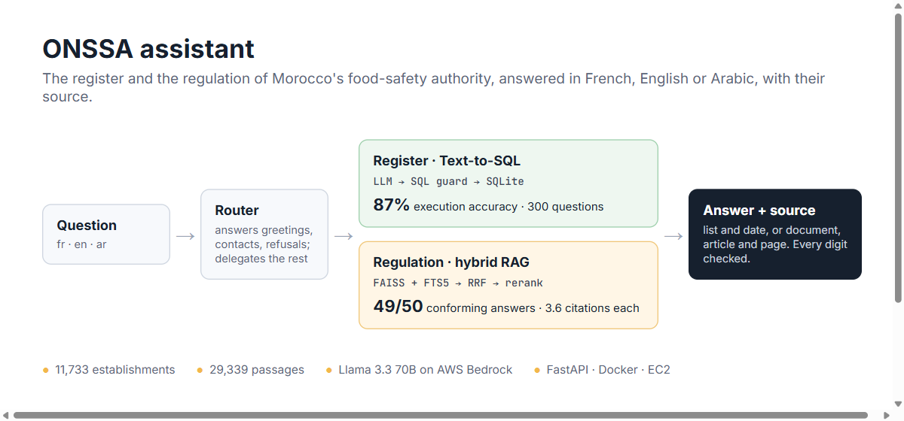
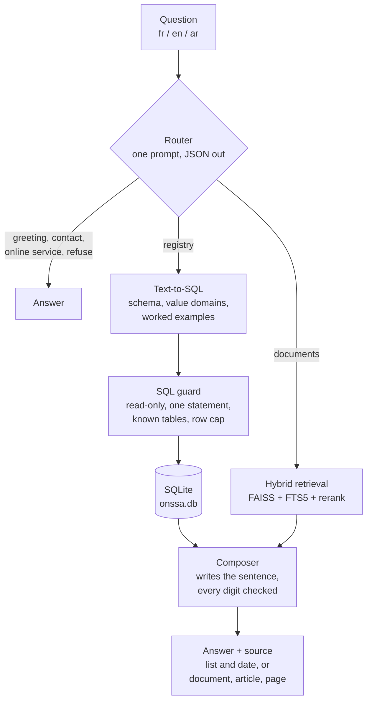
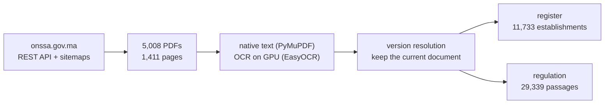
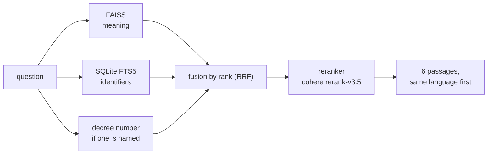

# ONSSA assistant: the register and the regulation, answered with their source

> Ask in French, English or Arabic who is approved by Morocco's food-safety authority, how many, where, or what the regulation says. Get the answer, the query or the passage behind it, and the document it comes from. Built during my AI Engineer internship at Alphastra, for ONSSA.

  

**About this repository.** This is the **architecture case study**: the problem, the design, the measurements, and the decisions they led to.

## The problem

ONSSA (Office National de Sécurité Sanitaire des produits Alimentaires) publishes its register of approved establishments and its regulation on onssa.gov.ma, but as PDF files: 56 lists for the register, hundreds of decrees and orders for the regulation, some native, some scanned, often several versions of the same document. Answering *is my supplier approved?* or *what does the decree require for cold storage?* means knowing which PDF to open.

The brief: answer those questions directly, in the visitor's language, and never give an answer that cannot be traced back to a published document.

| | Use case 1: the register | Use case 2: the regulation |
|---|---|---|
| question | who is approved, how many, where, since when | what does the text say |
| source | 11,733 establishments from 56 published lists | 29,339 passages of published text |
| method | one SQL query, checked before it runs | hybrid search, then a reranker |
| the answer rests on | a query anyone can re-run | a passage printed beside the answer |
| citation | the ONSSA list and its date | the document, the article and the page |
| measured | **87%** execution accuracy, 300 questions | **98%** conforming behaviour, 50 questions |

## How it works

1. **The router answers what needs no data.** A greeting, a phone number, a link to an online service or a refusal is answered by the router itself, from the ONSSA directory held in its prompt. It delegates the rest, untouched: a use case that receives pre-parsed fields can only answer the questions someone anticipated.
2. **Text-to-SQL, then a guard.** The model writes one query against a single serving database. Before it runs, a guard parses it and rejects anything that writes, chains statements, touches an unknown table or returns too many rows.
3. **The composer is the only module that writes to the user.** The model phrases the sentence, then every number in it is checked against the rows it was given. A sentence with a number the rows do not contain is replaced by a template.
4. **No citation, no answer.** For the regulation, the handler refuses to call an uncited answer an answer, whatever the model claims. That is the prose equivalent of the digit check.

## The data pipeline

The site publishes PDFs and web pages, not a database, so everything starts with a crawl.

- **Version resolution.** The same list was often published many times (23 copies of one certificate list, all flagged as current). Only the latest version of each document is kept, which removed 1,250 duplicates from the retrieval corpus.
- **Decoding the register.** Province, region, activity and status are recovered from the approval number, town names and list titles, so a question about "Casablanca" or "abattoirs" maps to exact values.
- **One serving database.** Two databases (45.7 MB) became one file of 9.7 MB covering 8 entity types, from food establishments to vessels and laboratories.

## Retrieval for the regulation

- **An article is never split.** Decrees are cut on their articles ("Article premier", "Art. 2", "المادة 2"); only an article longer than 1,400 characters is windowed, and it keeps its number. Cutting an article separates a rule from its condition.
- **The page number survives chunking.** Offsets are kept through the cut, so each passage cites its page range; 6,754 passages straddle two pages and cite both.
- **The embedding model was chosen by measurement.** Six decrees exist in both French and Arabic. Each French text was embedded and asked to find its own translation: Cohere embed v4 matched 6 of 6, against 5 of 6 for the two alternatives available on Bedrock.
- **Two searches because each misses what the other finds.** Dense vectors find a question phrased in its own words and miss exact strings like decree numbers; full-text search does the opposite. Their scores are not comparable, so they are merged by rank.
- **The reranker earns its 167 ms.** Fusion scores inside the top six were nearly flat (0.0315 to 0.0277), so their order was close to arbitrary. After reranking they spread from 0.80 to 0.69. If the call fails, the fusion order is returned unchanged.

## Evaluation

**Use case 1, the register.** 300 questions, 100 in each language, and they are **not translations of each other**: three different sets measure whether the assistant answers the people who actually write in each language. A query is correct when its result equals the result of a hand-written reference query, and expected results are executed at build time, never typed, so they survive a rebuild of the data. Llama 3.3 70B reached **87%**, and was compared against Qwen3 32B, Qwen3-coder 30B and Mistral 7B before being chosen.

**The prompt experiment.** Same model, 100 French questions, two kinds of change: removing sections from the working prompt, and replacing it with a clean-sheet rewrite.

| Prompt | Score |
|---|---|
| working prompt: schema, exact values, semantics, worked examples | **97%** |
| minus the exact-values section | 96% |
| minus the worked examples | 90% |
| minus both | 88% |
| best clean-sheet rewrite (reference-card style) | 74% |
| worst clean-sheet rewrite (specification style) | 41% |

Every rewrite lost by 23 to 56 points. The worked examples carried the most weight.

**Use case 2, the regulation.** 50 questions, graded on behaviour.

| | |
|---|---|
| conforming behaviour | **49 / 50** |
| answered and cited, of 44 answerable | 43 |
| correctly refused, of 6 with no answer | 6 |
| French / English / Arabic | 100% / 100% / 93.3% |
| citations per answer | 3.6 |
| latency p50 / p95 | 4.1 s / 6.6 s |

Adding the second use case did not disturb the first: re-tested the same day, 44 of 44 registry questions were routed correctly.

## Stack

| Layer | Choice | Why |
|---|---|---|
| LLM | Llama 3.3 70B on AWS Bedrock | best execution accuracy of the four models compared |
| Database | SQLite | one 9.7 MB read-only file, shipped next to the service |
| SQL guard | sqlglot | parse the query instead of pattern-matching it |
| Retrieval | FAISS + SQLite FTS5 | meaning and identifiers, merged by rank |
| Embeddings, rerank | Cohere embed v4, rerank v3.5 | chosen on a French-Arabic matching test |
| Service | FastAPI + a web interface | one answer contract for every route |
| Hosting | AWS EC2 (systemd, then Docker), S3 | credentials from the instance role, no key on the machine |
| Ingestion | PyMuPDF, EasyOCR | native text where it exists, OCR on a GPU where it does not |

## What I learned building it

- **Measure the choice, not the fashion.** The embedding model, the reranker and the prompt were each kept or dropped on a number measured on this corpus. The reranker stayed because the fusion order was flat; the clean-sheet prompts went because they lost.
- **A benchmark in three languages is three benchmarks.** Translating one question set measures the translation. Writing three sets measured what Arabic speakers actually ask, and that is where the errors were.
- **Guards are what make a model usable.** The SQL guard, the digit check and the citation rule each turn a confident wrong answer into a refusal or a template, which is the failure a public institution can live with.
- **Respect the unit of the document.** For legal text the article is the unit of meaning. Chunking on it, and keeping the page, is what makes a citation checkable.

## Context

Built during an AI Engineer internship at **Alphastra**, for **ONSSA**, from July to September 2026 (remote). The assistant was deployed on AWS.

## Author

**Zakariae Boui** ([GitHub](https://github.com/zakariae-boui)). See also [atlas-hcp-assistant](https://github.com/zakariae-boui/atlas-hcp-assistant), the assistant I built for Morocco's national statistics.

## License

The write-up and diagrams in this repository are MIT licensed (see [LICENSE](LICENSE)).
